# Viagens: o que cada modelo previu

<!-- Gerado por ais.cli.build_trip_gallery. Não editar à mão. -->

Uma imagem por viagem dos conjuntos de teste e de validação, com a classe de cada ponto: **azul** é navegação e **laranja** é pesca. O método e a discussão estão no relatório ([`latex/relatorio_pt.tex`](../latex/relatorio_pt.tex)).

| Linha | O que é |
|---|---|
| real | classe anotada no conjunto de dados |
| baseline | CNN 1D sobre a viagem completa (no relatório chama-se «referência») |
| J0 | a mesma CNN em janelas de 64 pontos, sem sobreposição |
| J50 | a mesma CNN em janelas de 64 pontos, com 50 % de sobreposição |
| baseline + pós-processamento | a baseline depois de um filtro gaussiano de 301 pontos sobre as probabilidades |

## Como ler estes resultados

- O conjunto de **teste** serviu para escolher épocas, limiares e a janela do filtro: os seus resultados são **otimistas**.
- Na **validação**, só a baseline é a medição final. O filtro **não é uma medição independente**: antes dele aplicou-se à validação uma versão de 13 pontos. J0 e J50 não foram medidos neste conjunto.
- O filtro aplica-se só à baseline. Estas imagens servem para ver, não para escolher valores.
- O eixo horizontal conta pontos e não tempo. Nas viagens longas há vários pontos por píxel, e um bloco muito curto aparece esbatido ou quase não se vê: a tabela conta todos os segmentos.
- Em cada conjunto, as viagens estão por ordem crescente de exatidão da baseline.

Dados: Song Wu, *Detailed Labelled Fishing Trajectories from AIS*, Zenodo, [10.5281/zenodo.7283281](https://doi.org/10.5281/zenodo.7283281), [CC BY 4.0](https://creativecommons.org/licenses/by/4.0/). As imagens são derivadas desses dados e das previsões deste projeto.

**Conjuntos:** [Teste (18 viagens)](#teste) · [Validação (18 viagens)](#validacao)

## Teste

Viagens: [220006000-2](#220006000-2) · [219001624-2](#219001624-2) · [219028381-4](#219028381-4) · [232020276-3](#232020276-3) · [219004596-2](#219004596-2) · [232020276-2](#232020276-2) · [219002409-2](#219002409-2) · [219001682-2](#219001682-2) · [219000855-4](#219000855-4) · [219025739-4](#219025739-4) · [219025740-6](#219025740-6) · [219000855-3](#219000855-3) · [220349000-3](#220349000-3) · [219007027-3](#219007027-3) · [219005671-2](#219005671-2) · [219004203-3](#219004203-3) · [219015617-2](#219015617-2) · [219001604-2](#219001604-2)

### 220006000-2

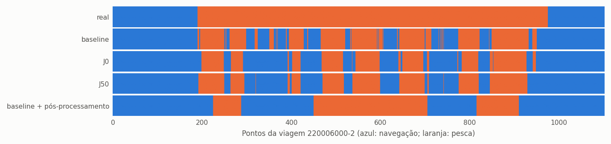

1 102 pontos; segmentos de pesca reais: 1.

| Linha | Exatidão | Segmentos de pesca previstos |
|---|---:|---:|
| baseline | 74,0 % | 29 |
| J0 | 63,8 % | 15 |
| J50 | 66,4 % | 12 |
| baseline + pós-processamento | 66,2 % | 3 |

[Voltar ao topo](#viagens-o-que-cada-modelo-previu)

### 219001624-2

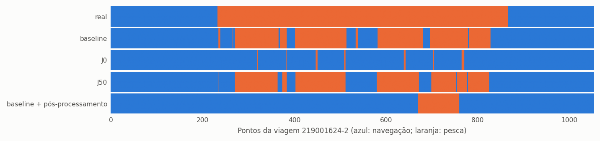

1 053 pontos; segmentos de pesca reais: 1.

| Linha | Exatidão | Segmentos de pesca previstos |
|---|---:|---:|
| baseline | 83,7 % | 9 |
| J0 | 42,0 % | 7 |
| J50 | 80,4 % | 8 |
| baseline + pós-processamento | 48,4 % | 1 |

[Voltar ao topo](#viagens-o-que-cada-modelo-previu)

### 219028381-4

1 392 pontos; segmentos de pesca reais: 1.

| Linha | Exatidão | Segmentos de pesca previstos |
|---|---:|---:|
| baseline | 83,8 % | 18 |
| J0 | 81,8 % | 11 |
| J50 | 80,0 % | 12 |
| baseline + pós-processamento | 95,5 % | 2 |

[Voltar ao topo](#viagens-o-que-cada-modelo-previu)

### 232020276-3

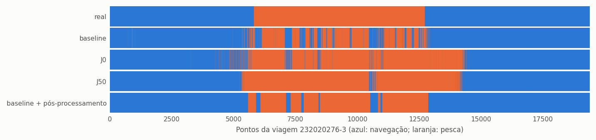

19 390 pontos; segmentos de pesca reais: 1.

| Linha | Exatidão | Segmentos de pesca previstos |
|---|---:|---:|
| baseline | 87,5 % | 121 |
| J0 | 87,3 % | 123 |
| J50 | 89,2 % | 52 |
| baseline + pós-processamento | 93,4 % | 7 |

[Voltar ao topo](#viagens-o-que-cada-modelo-previu)

### 219004596-2

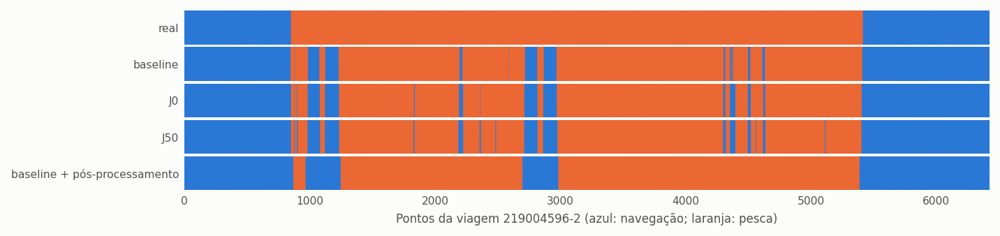

6 423 pontos; segmentos de pesca reais: 1.

| Linha | Exatidão | Segmentos de pesca previstos |
|---|---:|---:|
| baseline | 92,2 % | 17 |
| J0 | 91,0 % | 15 |
| J50 | 89,9 % | 19 |
| baseline + pós-processamento | 90,5 % | 3 |

[Voltar ao topo](#viagens-o-que-cada-modelo-previu)

### 232020276-2

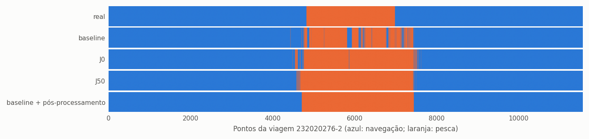

11 558 pontos; segmentos de pesca reais: 1.

| Linha | Exatidão | Segmentos de pesca previstos |
|---|---:|---:|
| baseline | 93,4 % | 48 |
| J0 | 94,1 % | 20 |
| J50 | 94,3 % | 18 |
| baseline + pós-processamento | 95,0 % | 1 |

[Voltar ao topo](#viagens-o-que-cada-modelo-previu)

### 219002409-2

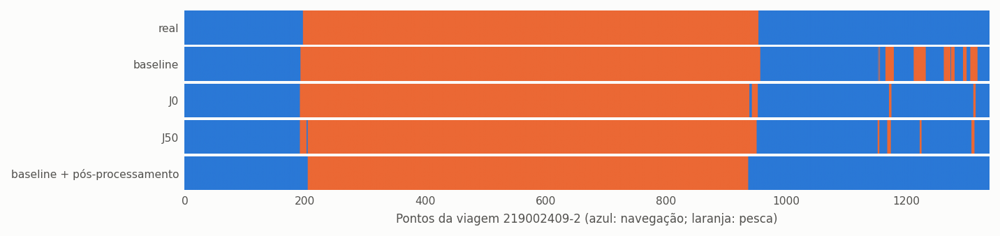

1 338 pontos; segmentos de pesca reais: 1.

| Linha | Exatidão | Segmentos de pesca previstos |
|---|---:|---:|
| baseline | 94,2 % | 9 |
| J0 | 98,7 % | 4 |
| J50 | 98,0 % | 6 |
| baseline + pós-processamento | 98,1 % | 1 |

[Voltar ao topo](#viagens-o-que-cada-modelo-previu)

### 219001682-2

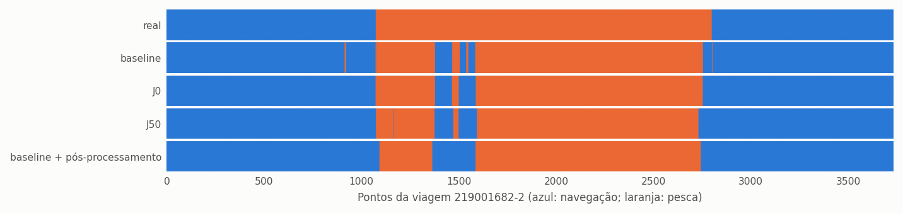

3 731 pontos; segmentos de pesca reais: 1.

| Linha | Exatidão | Segmentos de pesca previstos |
|---|---:|---:|
| baseline | 94,3 % | 8 |
| J0 | 94,1 % | 3 |
| J50 | 93,0 % | 4 |
| baseline + pós-processamento | 92,0 % | 2 |

[Voltar ao topo](#viagens-o-que-cada-modelo-previu)

### 219000855-4

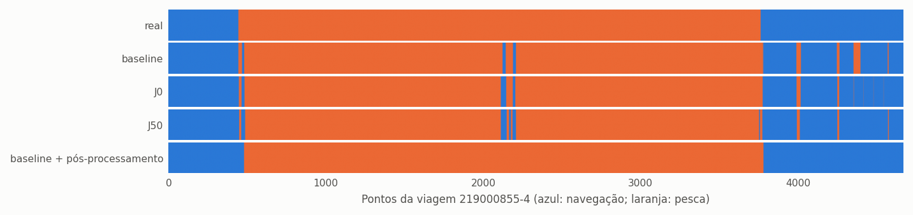

4 669 pontos; segmentos de pesca reais: 1.

| Linha | Exatidão | Segmentos de pesca previstos |
|---|---:|---:|
| baseline | 96,5 % | 9 |
| J0 | 97,3 % | 11 |
| J50 | 96,7 % | 9 |
| baseline + pós-processamento | 98,8 % | 1 |

[Voltar ao topo](#viagens-o-que-cada-modelo-previu)

### 219025739-4

5 416 pontos; segmentos de pesca reais: 1.

| Linha | Exatidão | Segmentos de pesca previstos |
|---|---:|---:|
| baseline | 97,7 % | 28 |
| J0 | 88,6 % | 78 |
| J50 | 91,0 % | 59 |
| baseline + pós-processamento | 98,8 % | 1 |

[Voltar ao topo](#viagens-o-que-cada-modelo-previu)

### 219025740-6

9 846 pontos; segmentos de pesca reais: 1.

| Linha | Exatidão | Segmentos de pesca previstos |
|---|---:|---:|
| baseline | 98,1 % | 9 |
| J0 | 95,1 % | 49 |
| J50 | 94,9 % | 44 |
| baseline + pós-processamento | 98,0 % | 3 |

[Voltar ao topo](#viagens-o-que-cada-modelo-previu)

### 219000855-3

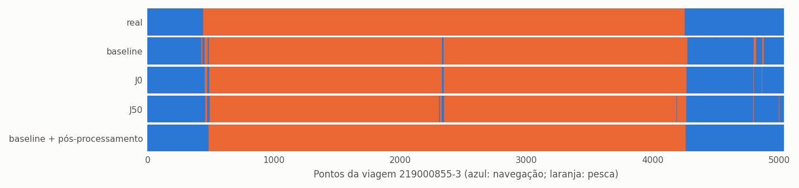

5 039 pontos; segmentos de pesca reais: 1.

| Linha | Exatidão | Segmentos de pesca previstos |
|---|---:|---:|
| baseline | 98,1 % | 9 |
| J0 | 98,7 % | 5 |
| J50 | 98,2 % | 7 |
| baseline + pós-processamento | 99,0 % | 1 |

[Voltar ao topo](#viagens-o-que-cada-modelo-previu)

### 220349000-3

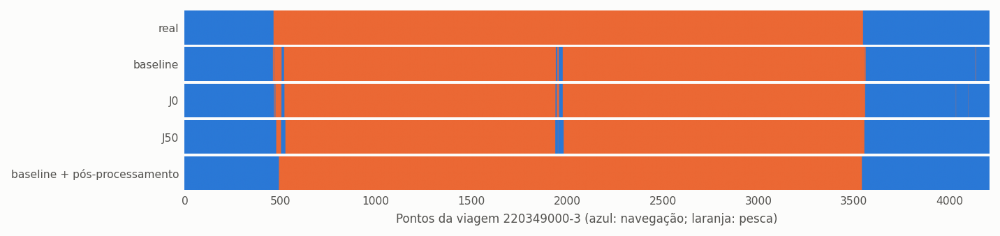

4 207 pontos; segmentos de pesca reais: 1.

| Linha | Exatidão | Segmentos de pesca previstos |
|---|---:|---:|
| baseline | 98,5 % | 7 |
| J0 | 98,6 % | 8 |
| J50 | 97,9 % | 4 |
| baseline + pós-processamento | 99,2 % | 1 |

[Voltar ao topo](#viagens-o-que-cada-modelo-previu)

### 219007027-3

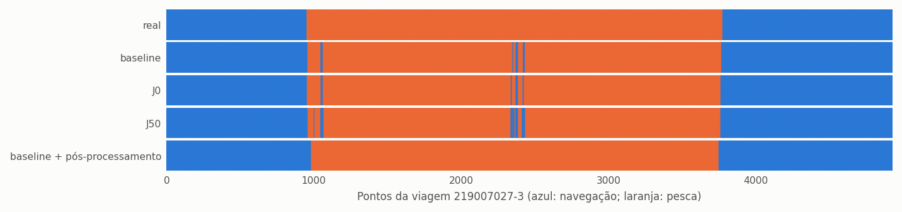

4 925 pontos; segmentos de pesca reais: 1.

| Linha | Exatidão | Segmentos de pesca previstos |
|---|---:|---:|
| baseline | 98,7 % | 6 |
| J0 | 98,8 % | 5 |
| J50 | 97,6 % | 7 |
| baseline + pós-processamento | 98,9 % | 1 |

[Voltar ao topo](#viagens-o-que-cada-modelo-previu)

### 219005671-2

5 481 pontos; segmentos de pesca reais: 1.

| Linha | Exatidão | Segmentos de pesca previstos |
|---|---:|---:|
| baseline | 98,7 % | 14 |
| J0 | 99,4 % | 6 |
| J50 | 96,7 % | 21 |
| baseline + pós-processamento | 98,7 % | 1 |

[Voltar ao topo](#viagens-o-que-cada-modelo-previu)

### 219004203-3

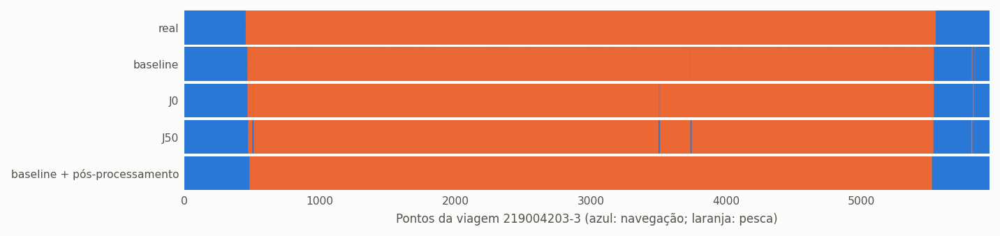

5 943 pontos; segmentos de pesca reais: 1.

| Linha | Exatidão | Segmentos de pesca previstos |
|---|---:|---:|
| baseline | 99,4 % | 4 |
| J0 | 99,4 % | 5 |
| J50 | 98,8 % | 5 |
| baseline + pós-processamento | 99,1 % | 1 |

[Voltar ao topo](#viagens-o-que-cada-modelo-previu)

### 219015617-2

4 821 pontos; segmentos de pesca reais: 1.

| Linha | Exatidão | Segmentos de pesca previstos |
|---|---:|---:|
| baseline | 99,5 % | 6 |
| J0 | 99,2 % | 5 |
| J50 | 98,8 % | 8 |
| baseline + pós-processamento | 99,1 % | 1 |

[Voltar ao topo](#viagens-o-que-cada-modelo-previu)

### 219001604-2

7 075 pontos; segmentos de pesca reais: 1.

| Linha | Exatidão | Segmentos de pesca previstos |
|---|---:|---:|
| baseline | 99,8 % | 7 |
| J0 | 99,6 % | 7 |
| J50 | 97,9 % | 8 |
| baseline + pós-processamento | 99,5 % | 1 |

[Voltar ao topo](#viagens-o-que-cada-modelo-previu)

## Validação

Viagens: [219020187-4](#219020187-4) · [220204000-3](#220204000-3) · [219012671-2](#219012671-2) · [220335000-2](#220335000-2) · [219004343-1](#219004343-1) · [219796000-2](#219796000-2) · [219007027-2](#219007027-2) · [219004128-2](#219004128-2) · [220307000-3](#220307000-3) · [219027026-2](#219027026-2) · [211477000-2](#211477000-2) · [219009738-2](#219009738-2) · [219709000-2](#219709000-2) · [220307000-4](#220307000-4) · [219025740-2](#219025740-2) · [220356000-3](#220356000-3) · [219004128-4](#219004128-4) · [220351000-2](#220351000-2)

### 219020187-4

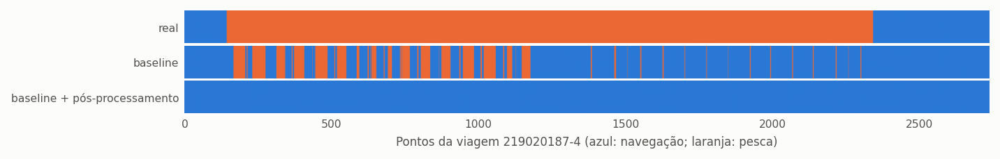

2 738 pontos; segmentos de pesca reais: 1.

| Linha | Exatidão | Segmentos de pesca previstos |
|---|---:|---:|
| baseline | 40,4 % | 49 |
| baseline + pós-processamento | 19,7 % | 0 |

[Voltar ao topo](#viagens-o-que-cada-modelo-previu)

### 220204000-3

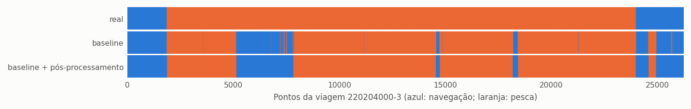

26 239 pontos; segmentos de pesca reais: 1.

| Linha | Exatidão | Segmentos de pesca previstos |
|---|---:|---:|
| baseline | 87,0 % | 42 |
| baseline + pós-processamento | 86,6 % | 5 |

[Voltar ao topo](#viagens-o-que-cada-modelo-previu)

### 219012671-2

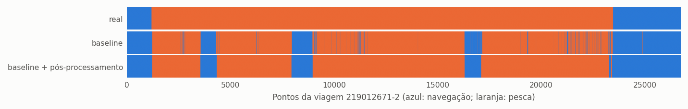

26 727 pontos; segmentos de pesca reais: 1.

| Linha | Exatidão | Segmentos de pesca previstos |
|---|---:|---:|
| baseline | 87,7 % | 122 |
| baseline + pós-processamento | 89,6 % | 5 |

[Voltar ao topo](#viagens-o-que-cada-modelo-previu)

### 220335000-2

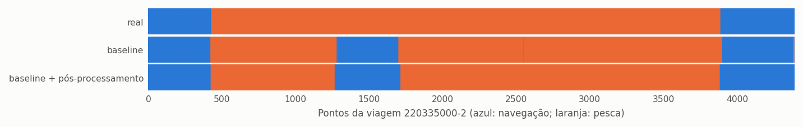

4 389 pontos; segmentos de pesca reais: 1.

| Linha | Exatidão | Segmentos de pesca previstos |
|---|---:|---:|
| baseline | 89,9 % | 5 |
| baseline + pós-processamento | 89,7 % | 2 |

[Voltar ao topo](#viagens-o-que-cada-modelo-previu)

### 219004343-1

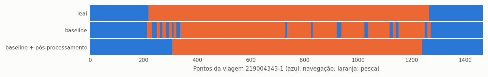

1 466 pontos; segmentos de pesca reais: 1.

| Linha | Exatidão | Segmentos de pesca previstos |
|---|---:|---:|
| baseline | 90,2 % | 14 |
| baseline + pós-processamento | 92,2 % | 1 |

[Voltar ao topo](#viagens-o-que-cada-modelo-previu)

### 219796000-2

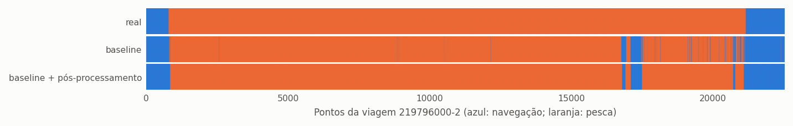

22 522 pontos; segmentos de pesca reais: 1.

| Linha | Exatidão | Segmentos de pesca previstos |
|---|---:|---:|
| baseline | 95,4 % | 86 |
| baseline + pós-processamento | 96,8 % | 4 |

[Voltar ao topo](#viagens-o-que-cada-modelo-previu)

### 219007027-2

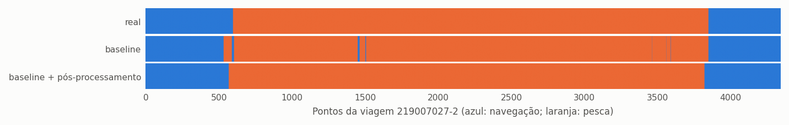

4 340 pontos; segmentos de pesca reais: 1.

| Linha | Exatidão | Segmentos de pesca previstos |
|---|---:|---:|
| baseline | 98,0 % | 7 |
| baseline + pós-processamento | 98,7 % | 1 |

[Voltar ao topo](#viagens-o-que-cada-modelo-previu)

### 219004128-2

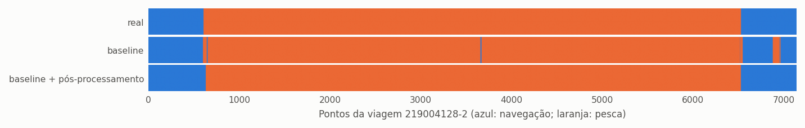

7 139 pontos; segmentos de pesca reais: 1.

| Linha | Exatidão | Segmentos de pesca previstos |
|---|---:|---:|
| baseline | 98,2 % | 7 |
| baseline + pós-processamento | 99,6 % | 1 |

[Voltar ao topo](#viagens-o-que-cada-modelo-previu)

### 220307000-3

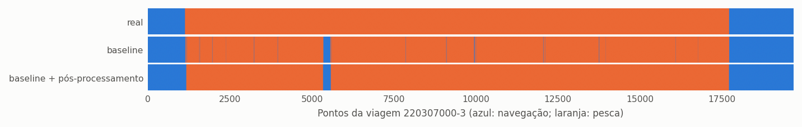

19 677 pontos; segmentos de pesca reais: 1.

| Linha | Exatidão | Segmentos de pesca previstos |
|---|---:|---:|
| baseline | 98,2 % | 26 |
| baseline + pós-processamento | 98,6 % | 2 |

[Voltar ao topo](#viagens-o-que-cada-modelo-previu)

### 219027026-2

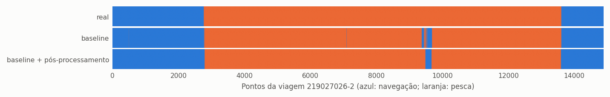

14 880 pontos; segmentos de pesca reais: 1.

| Linha | Exatidão | Segmentos de pesca previstos |
|---|---:|---:|
| baseline | 98,2 % | 15 |
| baseline + pós-processamento | 98,5 % | 2 |

[Voltar ao topo](#viagens-o-que-cada-modelo-previu)

### 211477000-2

5 610 pontos; segmentos de pesca reais: 1.

| Linha | Exatidão | Segmentos de pesca previstos |
|---|---:|---:|
| baseline | 98,3 % | 12 |
| baseline + pós-processamento | 98,7 % | 1 |

[Voltar ao topo](#viagens-o-que-cada-modelo-previu)

### 219009738-2

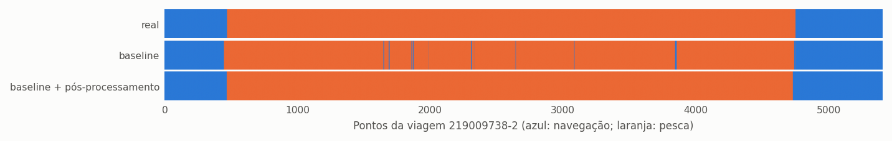

5 406 pontos; segmentos de pesca reais: 1.

| Linha | Exatidão | Segmentos de pesca previstos |
|---|---:|---:|
| baseline | 98,4 % | 16 |
| baseline + pós-processamento | 99,6 % | 1 |

[Voltar ao topo](#viagens-o-que-cada-modelo-previu)

### 219709000-2

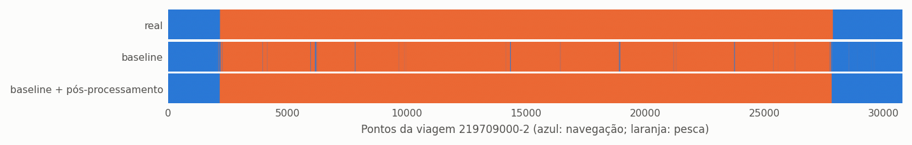

30 772 pontos; segmentos de pesca reais: 1.

| Linha | Exatidão | Segmentos de pesca previstos |
|---|---:|---:|
| baseline | 98,6 % | 48 |
| baseline + pós-processamento | 99,8 % | 1 |

[Voltar ao topo](#viagens-o-que-cada-modelo-previu)

### 220307000-4

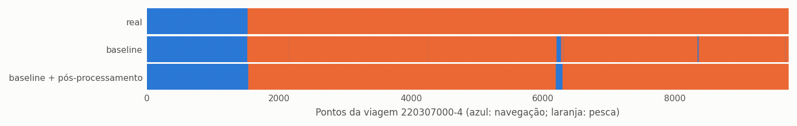

9 722 pontos; segmentos de pesca reais: 1.

| Linha | Exatidão | Segmentos de pesca previstos |
|---|---:|---:|
| baseline | 99,0 % | 8 |
| baseline + pós-processamento | 98,8 % | 2 |

[Voltar ao topo](#viagens-o-que-cada-modelo-previu)

### 219025740-2

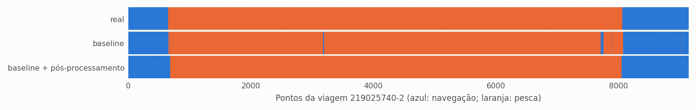

9 146 pontos; segmentos de pesca reais: 1.

| Linha | Exatidão | Segmentos de pesca previstos |
|---|---:|---:|
| baseline | 99,0 % | 9 |
| baseline + pós-processamento | 99,5 % | 1 |

[Voltar ao topo](#viagens-o-que-cada-modelo-previu)

### 220356000-3

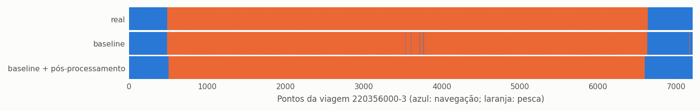

7 205 pontos; segmentos de pesca reais: 1.

| Linha | Exatidão | Segmentos de pesca previstos |
|---|---:|---:|
| baseline | 99,5 % | 11 |
| baseline + pós-processamento | 99,2 % | 1 |

[Voltar ao topo](#viagens-o-que-cada-modelo-previu)

### 219004128-4

6 700 pontos; segmentos de pesca reais: 1.

| Linha | Exatidão | Segmentos de pesca previstos |
|---|---:|---:|
| baseline | 99,6 % | 4 |
| baseline + pós-processamento | 99,3 % | 1 |

[Voltar ao topo](#viagens-o-que-cada-modelo-previu)

### 220351000-2

4 338 pontos; segmentos de pesca reais: 1.

| Linha | Exatidão | Segmentos de pesca previstos |
|---|---:|---:|
| baseline | 99,7 % | 5 |
| baseline + pós-processamento | 99,6 % | 1 |

[Voltar ao topo](#viagens-o-que-cada-modelo-previu)
